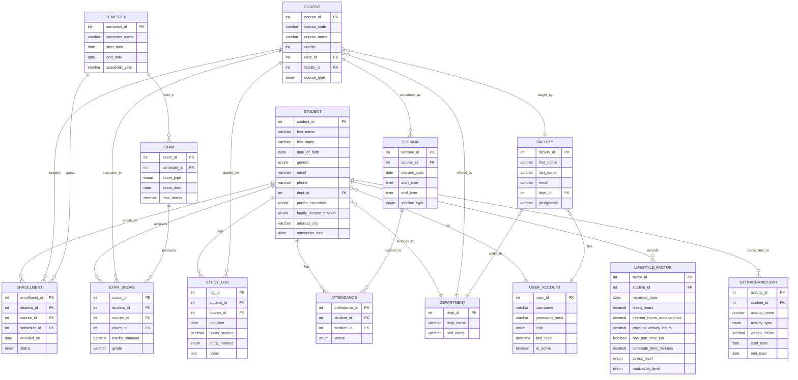
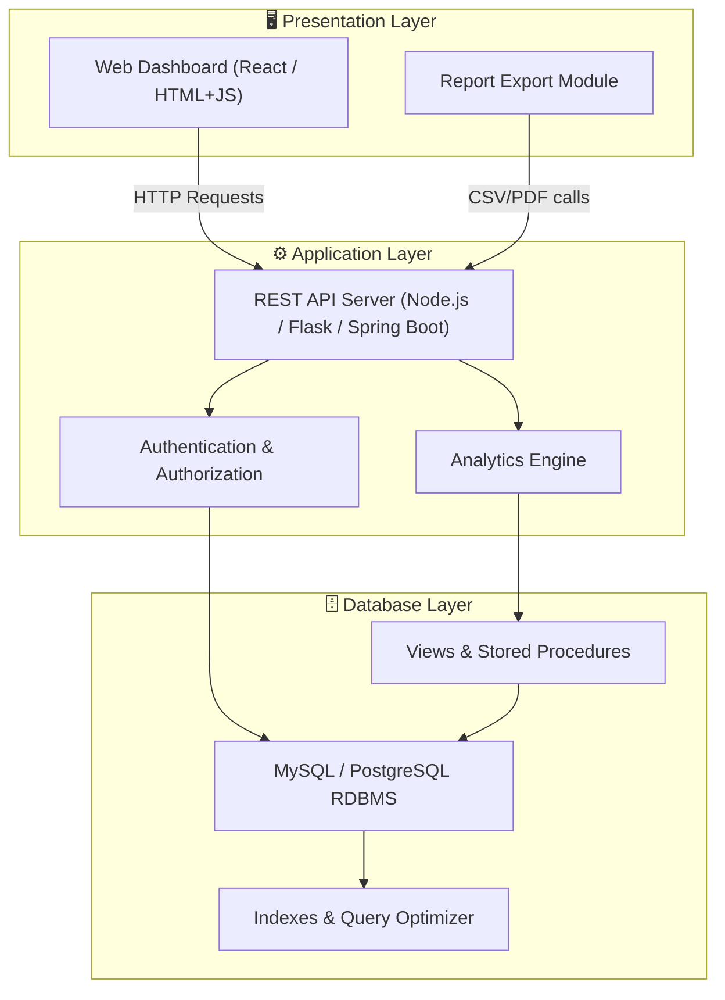
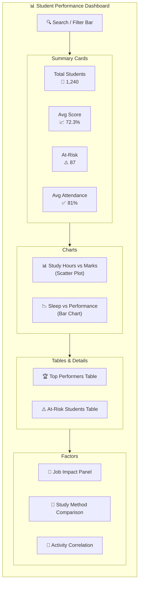
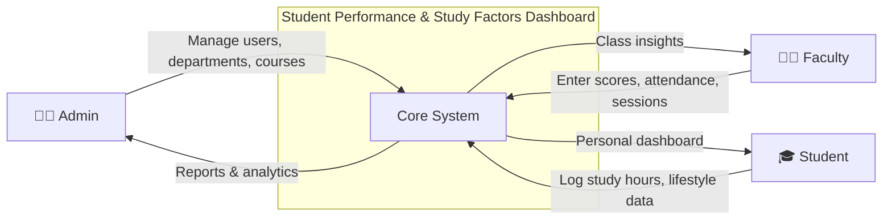
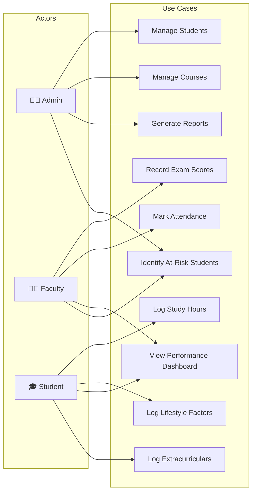

# 📊 Student Performance & Study Factors Dashboard — Software Model

> **Course:** Database Management Systems (DBMS)
> **Project Type:** Dashboard Application with Relational Database Backend
> **Date:** November 2026

---

## 1. Project Overview

### 1.1 Problem Statement

Educational institutions lack a unified system to **track, analyze, and visualize** the relationship between student study habits, lifestyle factors, and academic performance. Existing systems store grades in isolation without correlating them with study hours, attendance, sleep patterns, extracurricular activities, or socio-economic factors.

### 1.2 Objective

Design and implement a **relational database-backed dashboard** that:

- Stores student demographics, academic records, and study behavior data
- Tracks lifestyle and environmental factors affecting performance
- Enables teachers and administrators to query insights and generate reports
- Visualizes trends, correlations, and at-risk student profiles

### 1.3 Scope

| In Scope | Out of Scope |
|----------|-------------|
| Student profile management | Real-time proctoring |
| Course & exam record storage | LMS integration |
| Study habits tracking | Payment / fee management |
| Attendance management | Alumni tracking |
| Lifestyle factor logging | Mobile app (frontend only) |
| Performance analytics & reports | AI-based predictions |

---

## 2. Requirements Analysis

### 2.1 Functional Requirements

| ID | Requirement | Priority |
|----|------------|----------|
| FR-01 | Register and manage student profiles (name, age, gender, contact, parental education, family income bracket) | High |
| FR-02 | Create and manage courses, subjects, and semesters | High |
| FR-03 | Record exam scores (internal, mid-term, final) per student per subject | High |
| FR-04 | Log daily/weekly study hours per student per subject | High |
| FR-05 | Track attendance (present/absent/late) per session | High |
| FR-06 | Record lifestyle factors (sleep hours, internet usage, physical activity, part-time job, commute time) | Medium |
| FR-07 | Log extracurricular participation (clubs, sports, volunteering) | Medium |
| FR-08 | Generate per-student performance reports | High |
| FR-09 | Dashboard queries: top performers, at-risk students, correlation views | High |
| FR-10 | Role-based access for Admin, Faculty, and Student | Medium |
| FR-11 | Export reports as CSV | Low |

### 2.2 Non-Functional Requirements

| ID | Requirement |
|----|------------|
| NFR-01 | Response time for dashboard queries ≤ 2 seconds |
| NFR-02 | Database must support concurrent access by 50+ users |
| NFR-03 | All passwords stored as salted hashes |
| NFR-04 | Data retained for a minimum of 5 academic years |
| NFR-05 | System available 99.5% uptime during academic sessions |

---

## 3. Entity-Relationship (ER) Diagram



---

## 4. Relational Schema (3NF)

> [!NOTE]
> All tables are normalized to **Third Normal Form (3NF)**. No transitive or partial dependencies exist. Composite keys are avoided in favor of surrogate primary keys for cleaner joins.

### 4.1 Table Definitions

#### `DEPARTMENT`
| Column | Type | Constraints |
|--------|------|------------|
| `dept_id` | INT | PRIMARY KEY, AUTO_INCREMENT |
| `dept_name` | VARCHAR(100) | NOT NULL, UNIQUE |
| `hod_name` | VARCHAR(100) | |

#### `FACULTY`
| Column | Type | Constraints |
|--------|------|------------|
| `faculty_id` | INT | PRIMARY KEY, AUTO_INCREMENT |
| `first_name` | VARCHAR(50) | NOT NULL |
| `last_name` | VARCHAR(50) | NOT NULL |
| `email` | VARCHAR(100) | NOT NULL, UNIQUE |
| `dept_id` | INT | FOREIGN KEY → DEPARTMENT(dept_id) |
| `designation` | VARCHAR(50) | |

#### `STUDENT`
| Column | Type | Constraints |
|--------|------|------------|
| `student_id` | INT | PRIMARY KEY, AUTO_INCREMENT |
| `first_name` | VARCHAR(50) | NOT NULL |
| `last_name` | VARCHAR(50) | NOT NULL |
| `date_of_birth` | DATE | NOT NULL |
| `gender` | ENUM('M','F','Other') | NOT NULL |
| `email` | VARCHAR(100) | NOT NULL, UNIQUE |
| `phone` | VARCHAR(15) | |
| `dept_id` | INT | FOREIGN KEY → DEPARTMENT(dept_id) |
| `parent_education` | ENUM('None','HighSchool','Bachelors','Masters','PhD') | |
| `family_income_bracket` | ENUM('Low','Middle','Upper-Middle','High') | |
| `address_city` | VARCHAR(100) | |
| `admission_date` | DATE | NOT NULL |

#### `COURSE`
| Column | Type | Constraints |
|--------|------|------------|
| `course_id` | INT | PRIMARY KEY, AUTO_INCREMENT |
| `course_code` | VARCHAR(10) | NOT NULL, UNIQUE |
| `course_name` | VARCHAR(150) | NOT NULL |
| `credits` | INT | NOT NULL, CHECK (credits > 0) |
| `dept_id` | INT | FOREIGN KEY → DEPARTMENT(dept_id) |
| `faculty_id` | INT | FOREIGN KEY → FACULTY(faculty_id) |
| `course_type` | ENUM('Theory','Lab','Project') | NOT NULL |

#### `SEMESTER`
| Column | Type | Constraints |
|--------|------|------------|
| `semester_id` | INT | PRIMARY KEY, AUTO_INCREMENT |
| `semester_name` | VARCHAR(20) | NOT NULL |
| `start_date` | DATE | NOT NULL |
| `end_date` | DATE | NOT NULL |
| `academic_year` | VARCHAR(9) | NOT NULL |

#### `ENROLLMENT`
| Column | Type | Constraints |
|--------|------|------------|
| `enrollment_id` | INT | PRIMARY KEY, AUTO_INCREMENT |
| `student_id` | INT | FOREIGN KEY → STUDENT(student_id) |
| `course_id` | INT | FOREIGN KEY → COURSE(course_id) |
| `semester_id` | INT | FOREIGN KEY → SEMESTER(semester_id) |
| `enrolled_on` | DATE | NOT NULL |
| `status` | ENUM('Active','Dropped','Completed') | DEFAULT 'Active' |
| | | UNIQUE(student_id, course_id, semester_id) |

#### `SESSION`
| Column | Type | Constraints |
|--------|------|------------|
| `session_id` | INT | PRIMARY KEY, AUTO_INCREMENT |
| `course_id` | INT | FOREIGN KEY → COURSE(course_id) |
| `session_date` | DATE | NOT NULL |
| `start_time` | TIME | NOT NULL |
| `end_time` | TIME | NOT NULL |
| `session_type` | ENUM('Lecture','Lab','Tutorial') | NOT NULL |

#### `ATTENDANCE`
| Column | Type | Constraints |
|--------|------|------------|
| `attendance_id` | INT | PRIMARY KEY, AUTO_INCREMENT |
| `student_id` | INT | FOREIGN KEY → STUDENT(student_id) |
| `session_id` | INT | FOREIGN KEY → SESSION(session_id) |
| `status` | ENUM('Present','Absent','Late') | NOT NULL |
| | | UNIQUE(student_id, session_id) |

#### `EXAM`
| Column | Type | Constraints |
|--------|------|------------|
| `exam_id` | INT | PRIMARY KEY, AUTO_INCREMENT |
| `semester_id` | INT | FOREIGN KEY → SEMESTER(semester_id) |
| `exam_type` | ENUM('Internal','MidTerm','Final') | NOT NULL |
| `exam_date` | DATE | NOT NULL |
| `max_marks` | DECIMAL(5,2) | NOT NULL |

#### `EXAM_SCORE`
| Column | Type | Constraints |
|--------|------|------------|
| `score_id` | INT | PRIMARY KEY, AUTO_INCREMENT |
| `student_id` | INT | FOREIGN KEY → STUDENT(student_id) |
| `course_id` | INT | FOREIGN KEY → COURSE(course_id) |
| `exam_id` | INT | FOREIGN KEY → EXAM(exam_id) |
| `marks_obtained` | DECIMAL(5,2) | NOT NULL, CHECK (marks_obtained >= 0) |
| `grade` | VARCHAR(2) | |
| | | UNIQUE(student_id, course_id, exam_id) |

#### `STUDY_LOG`
| Column | Type | Constraints |
|--------|------|------------|
| `log_id` | INT | PRIMARY KEY, AUTO_INCREMENT |
| `student_id` | INT | FOREIGN KEY → STUDENT(student_id) |
| `course_id` | INT | FOREIGN KEY → COURSE(course_id) |
| `log_date` | DATE | NOT NULL |
| `hours_studied` | DECIMAL(4,2) | NOT NULL, CHECK (hours_studied >= 0) |
| `study_method` | ENUM('Textbook','Video','GroupStudy','Practice','Online') | |
| `notes` | TEXT | |

#### `LIFESTYLE_FACTOR`
| Column | Type | Constraints |
|--------|------|------------|
| `factor_id` | INT | PRIMARY KEY, AUTO_INCREMENT |
| `student_id` | INT | FOREIGN KEY → STUDENT(student_id) |
| `recorded_date` | DATE | NOT NULL |
| `sleep_hours` | DECIMAL(3,1) | CHECK (sleep_hours BETWEEN 0 AND 24) |
| `internet_hours_nonacademic` | DECIMAL(3,1) | |
| `physical_activity_hours` | DECIMAL(3,1) | |
| `has_part_time_job` | BOOLEAN | DEFAULT FALSE |
| `commute_time_minutes` | DECIMAL(5,1) | |
| `stress_level` | ENUM('Low','Moderate','High','VeryHigh') | |
| `motivation_level` | ENUM('Low','Moderate','High','VeryHigh') | |

#### `EXTRACURRICULAR`
| Column | Type | Constraints |
|--------|------|------------|
| `activity_id` | INT | PRIMARY KEY, AUTO_INCREMENT |
| `student_id` | INT | FOREIGN KEY → STUDENT(student_id) |
| `activity_name` | VARCHAR(100) | NOT NULL |
| `activity_type` | ENUM('Sports','Club','Volunteering','Arts','Technical') | |
| `weekly_hours` | DECIMAL(4,1) | |
| `start_date` | DATE | |
| `end_date` | DATE | |

#### `USER_ACCOUNT`
| Column | Type | Constraints |
|--------|------|------------|
| `user_id` | INT | PRIMARY KEY, AUTO_INCREMENT |
| `username` | VARCHAR(50) | NOT NULL, UNIQUE |
| `password_hash` | VARCHAR(255) | NOT NULL |
| `role` | ENUM('Admin','Faculty','Student') | NOT NULL |
| `last_login` | DATETIME | |
| `is_active` | BOOLEAN | DEFAULT TRUE |

---

## 5. Normalization Proof

### 5.1 First Normal Form (1NF) ✅
- All columns hold **atomic (single)** values — no repeating groups or arrays.
- Every table has a **primary key**.

### 5.2 Second Normal Form (2NF) ✅
- Surrogate keys (`student_id`, `course_id`, etc.) are used instead of composite keys.
- All non-key attributes are **fully functionally dependent** on the primary key.
- Example: In `EXAM_SCORE`, `marks_obtained` depends on `score_id` (the whole key), not on a partial key.

### 5.3 Third Normal Form (3NF) ✅
- **No transitive dependencies** exist.
- `dept_name` is stored only in `DEPARTMENT`, not repeated in `STUDENT` or `COURSE`.
- `hod_name` depends directly on `dept_id`, not transitively through another non-key.

---

## 6. System Architecture



### Technology Stack

| Layer | Technology Options |
|-------|-------------------|
| Frontend | React.js, Chart.js / D3.js, Tailwind CSS |
| Backend API | Node.js (Express) **or** Python (Flask/Django) **or** Java (Spring Boot) |
| Database | MySQL 8.0 **or** PostgreSQL 15 |
| Auth | JWT tokens with bcrypt password hashing |
| Hosting | Localhost (dev) / AWS RDS + EC2 (prod) |

---

## 7. SQL Implementation (DDL)

```sql
-- ============================================================
-- DATABASE CREATION
-- ============================================================
CREATE DATABASE IF NOT EXISTS student_performance_db;
USE student_performance_db;

-- ============================================================
-- TABLE: DEPARTMENT
-- ============================================================
CREATE TABLE Department (
    dept_id       INT AUTO_INCREMENT PRIMARY KEY,
    dept_name     VARCHAR(100) NOT NULL UNIQUE,
    hod_name      VARCHAR(100)
);

-- ============================================================
-- TABLE: FACULTY
-- ============================================================
CREATE TABLE Faculty (
    faculty_id    INT AUTO_INCREMENT PRIMARY KEY,
    first_name    VARCHAR(50)  NOT NULL,
    last_name     VARCHAR(50)  NOT NULL,
    email         VARCHAR(100) NOT NULL UNIQUE,
    dept_id       INT,
    designation   VARCHAR(50),
    FOREIGN KEY (dept_id) REFERENCES Department(dept_id)
        ON DELETE SET NULL ON UPDATE CASCADE
);

-- ============================================================
-- TABLE: USER_ACCOUNT
-- ============================================================
CREATE TABLE User_Account (
    user_id       INT AUTO_INCREMENT PRIMARY KEY,
    username      VARCHAR(50)  NOT NULL UNIQUE,
    password_hash VARCHAR(255) NOT NULL,
    role          ENUM('Admin','Faculty','Student') NOT NULL,
    last_login    DATETIME,
    is_active     BOOLEAN DEFAULT TRUE
);

-- ============================================================
-- TABLE: STUDENT
-- ============================================================
CREATE TABLE Student (
    student_id            INT AUTO_INCREMENT PRIMARY KEY,
    first_name            VARCHAR(50) NOT NULL,
    last_name             VARCHAR(50) NOT NULL,
    date_of_birth         DATE NOT NULL,
    gender                ENUM('M','F','Other') NOT NULL,
    email                 VARCHAR(100) NOT NULL UNIQUE,
    phone                 VARCHAR(15),
    dept_id               INT,
    parent_education      ENUM('None','HighSchool','Bachelors','Masters','PhD'),
    family_income_bracket ENUM('Low','Middle','Upper-Middle','High'),
    address_city          VARCHAR(100),
    admission_date        DATE NOT NULL,
    user_id               INT UNIQUE,
    FOREIGN KEY (dept_id)  REFERENCES Department(dept_id)
        ON DELETE SET NULL ON UPDATE CASCADE,
    FOREIGN KEY (user_id)  REFERENCES User_Account(user_id)
        ON DELETE SET NULL ON UPDATE CASCADE
);

-- ============================================================
-- TABLE: COURSE
-- ============================================================
CREATE TABLE Course (
    course_id    INT AUTO_INCREMENT PRIMARY KEY,
    course_code  VARCHAR(10)  NOT NULL UNIQUE,
    course_name  VARCHAR(150) NOT NULL,
    credits      INT NOT NULL CHECK (credits > 0),
    dept_id      INT,
    faculty_id   INT,
    course_type  ENUM('Theory','Lab','Project') NOT NULL,
    FOREIGN KEY (dept_id)    REFERENCES Department(dept_id)
        ON DELETE SET NULL ON UPDATE CASCADE,
    FOREIGN KEY (faculty_id) REFERENCES Faculty(faculty_id)
        ON DELETE SET NULL ON UPDATE CASCADE
);

-- ============================================================
-- TABLE: SEMESTER
-- ============================================================
CREATE TABLE Semester (
    semester_id   INT AUTO_INCREMENT PRIMARY KEY,
    semester_name VARCHAR(20) NOT NULL,
    start_date    DATE NOT NULL,
    end_date      DATE NOT NULL,
    academic_year VARCHAR(9) NOT NULL
);

-- ============================================================
-- TABLE: ENROLLMENT
-- ============================================================
CREATE TABLE Enrollment (
    enrollment_id INT AUTO_INCREMENT PRIMARY KEY,
    student_id    INT NOT NULL,
    course_id     INT NOT NULL,
    semester_id   INT NOT NULL,
    enrolled_on   DATE NOT NULL,
    status        ENUM('Active','Dropped','Completed') DEFAULT 'Active',
    UNIQUE (student_id, course_id, semester_id),
    FOREIGN KEY (student_id)  REFERENCES Student(student_id)
        ON DELETE CASCADE ON UPDATE CASCADE,
    FOREIGN KEY (course_id)   REFERENCES Course(course_id)
        ON DELETE CASCADE ON UPDATE CASCADE,
    FOREIGN KEY (semester_id) REFERENCES Semester(semester_id)
        ON DELETE CASCADE ON UPDATE CASCADE
);

-- ============================================================
-- TABLE: SESSION
-- ============================================================
CREATE TABLE Session (
    session_id   INT AUTO_INCREMENT PRIMARY KEY,
    course_id    INT NOT NULL,
    session_date DATE NOT NULL,
    start_time   TIME NOT NULL,
    end_time     TIME NOT NULL,
    session_type ENUM('Lecture','Lab','Tutorial') NOT NULL,
    FOREIGN KEY (course_id) REFERENCES Course(course_id)
        ON DELETE CASCADE ON UPDATE CASCADE
);

-- ============================================================
-- TABLE: ATTENDANCE
-- ============================================================
CREATE TABLE Attendance (
    attendance_id INT AUTO_INCREMENT PRIMARY KEY,
    student_id    INT NOT NULL,
    session_id    INT NOT NULL,
    status        ENUM('Present','Absent','Late') NOT NULL,
    UNIQUE (student_id, session_id),
    FOREIGN KEY (student_id) REFERENCES Student(student_id)
        ON DELETE CASCADE ON UPDATE CASCADE,
    FOREIGN KEY (session_id) REFERENCES Session(session_id)
        ON DELETE CASCADE ON UPDATE CASCADE
);

-- ============================================================
-- TABLE: EXAM
-- ============================================================
CREATE TABLE Exam (
    exam_id      INT AUTO_INCREMENT PRIMARY KEY,
    semester_id  INT NOT NULL,
    exam_type    ENUM('Internal','MidTerm','Final') NOT NULL,
    exam_date    DATE NOT NULL,
    max_marks    DECIMAL(5,2) NOT NULL,
    FOREIGN KEY (semester_id) REFERENCES Semester(semester_id)
        ON DELETE CASCADE ON UPDATE CASCADE
);

-- ============================================================
-- TABLE: EXAM_SCORE
-- ============================================================
CREATE TABLE Exam_Score (
    score_id       INT AUTO_INCREMENT PRIMARY KEY,
    student_id     INT NOT NULL,
    course_id      INT NOT NULL,
    exam_id        INT NOT NULL,
    marks_obtained DECIMAL(5,2) NOT NULL CHECK (marks_obtained >= 0),
    grade          VARCHAR(2),
    UNIQUE (student_id, course_id, exam_id),
    FOREIGN KEY (student_id) REFERENCES Student(student_id)
        ON DELETE CASCADE ON UPDATE CASCADE,
    FOREIGN KEY (course_id)  REFERENCES Course(course_id)
        ON DELETE CASCADE ON UPDATE CASCADE,
    FOREIGN KEY (exam_id)    REFERENCES Exam(exam_id)
        ON DELETE CASCADE ON UPDATE CASCADE
);

-- ============================================================
-- TABLE: STUDY_LOG
-- ============================================================
CREATE TABLE Study_Log (
    log_id        INT AUTO_INCREMENT PRIMARY KEY,
    student_id    INT NOT NULL,
    course_id     INT NOT NULL,
    log_date      DATE NOT NULL,
    hours_studied DECIMAL(4,2) NOT NULL CHECK (hours_studied >= 0),
    study_method  ENUM('Textbook','Video','GroupStudy','Practice','Online'),
    notes         TEXT,
    FOREIGN KEY (student_id) REFERENCES Student(student_id)
        ON DELETE CASCADE ON UPDATE CASCADE,
    FOREIGN KEY (course_id)  REFERENCES Course(course_id)
        ON DELETE CASCADE ON UPDATE CASCADE
);

-- ============================================================
-- TABLE: LIFESTYLE_FACTOR
-- ============================================================
CREATE TABLE Lifestyle_Factor (
    factor_id                   INT AUTO_INCREMENT PRIMARY KEY,
    student_id                  INT NOT NULL,
    recorded_date               DATE NOT NULL,
    sleep_hours                 DECIMAL(3,1) CHECK (sleep_hours BETWEEN 0 AND 24),
    internet_hours_nonacademic  DECIMAL(3,1),
    physical_activity_hours     DECIMAL(3,1),
    has_part_time_job           BOOLEAN DEFAULT FALSE,
    commute_time_minutes        DECIMAL(5,1),
    stress_level                ENUM('Low','Moderate','High','VeryHigh'),
    motivation_level            ENUM('Low','Moderate','High','VeryHigh'),
    FOREIGN KEY (student_id) REFERENCES Student(student_id)
        ON DELETE CASCADE ON UPDATE CASCADE
);

-- ============================================================
-- TABLE: EXTRACURRICULAR
-- ============================================================
CREATE TABLE Extracurricular (
    activity_id   INT AUTO_INCREMENT PRIMARY KEY,
    student_id    INT NOT NULL,
    activity_name VARCHAR(100) NOT NULL,
    activity_type ENUM('Sports','Club','Volunteering','Arts','Technical'),
    weekly_hours  DECIMAL(4,1),
    start_date    DATE,
    end_date      DATE,
    FOREIGN KEY (student_id) REFERENCES Student(student_id)
        ON DELETE CASCADE ON UPDATE CASCADE
);
```

---

## 8. Key Indexes for Performance

```sql
-- Speed up student lookups
CREATE INDEX idx_student_dept    ON Student(dept_id);
CREATE INDEX idx_student_email   ON Student(email);

-- Speed up enrollment queries
CREATE INDEX idx_enrollment_student  ON Enrollment(student_id);
CREATE INDEX idx_enrollment_course   ON Enrollment(course_id);
CREATE INDEX idx_enrollment_semester ON Enrollment(semester_id);

-- Speed up exam score analytics
CREATE INDEX idx_score_student ON Exam_Score(student_id);
CREATE INDEX idx_score_course  ON Exam_Score(course_id);

-- Speed up attendance reports
CREATE INDEX idx_attendance_student ON Attendance(student_id);

-- Speed up study log date-range queries
CREATE INDEX idx_studylog_student_date ON Study_Log(student_id, log_date);

-- Speed up lifestyle factor analysis
CREATE INDEX idx_lifestyle_student_date ON Lifestyle_Factor(student_id, recorded_date);
```

---

## 9. Important Views (Virtual Tables)

```sql
-- ============================================================
-- VIEW: Student Performance Summary
-- ============================================================
CREATE VIEW vw_student_performance AS
SELECT
    s.student_id,
    CONCAT(s.first_name, ' ', s.last_name)   AS student_name,
    d.dept_name,
    c.course_name,
    e.exam_type,
    es.marks_obtained,
    e.max_marks,
    ROUND((es.marks_obtained / e.max_marks) * 100, 2) AS percentage,
    es.grade
FROM Exam_Score es
JOIN Student s   ON es.student_id = s.student_id
JOIN Course c    ON es.course_id  = c.course_id
JOIN Exam e      ON es.exam_id    = e.exam_id
JOIN Department d ON s.dept_id    = d.dept_id;

-- ============================================================
-- VIEW: Attendance Rate per Student per Course
-- ============================================================
CREATE VIEW vw_attendance_rate AS
SELECT
    s.student_id,
    CONCAT(s.first_name, ' ', s.last_name) AS student_name,
    c.course_name,
    COUNT(a.attendance_id) AS total_sessions,
    SUM(CASE WHEN a.status = 'Present' THEN 1 ELSE 0 END) AS present_count,
    ROUND(
        SUM(CASE WHEN a.status = 'Present' THEN 1 ELSE 0 END) * 100.0
        / COUNT(a.attendance_id), 2
    ) AS attendance_percentage
FROM Attendance a
JOIN Student s   ON a.student_id = s.student_id
JOIN Session ss  ON a.session_id = ss.session_id
JOIN Course c    ON ss.course_id = c.course_id
GROUP BY s.student_id, c.course_id;

-- ============================================================
-- VIEW: Study Hours vs. Performance Correlation
-- ============================================================
CREATE VIEW vw_study_vs_performance AS
SELECT
    s.student_id,
    CONCAT(s.first_name, ' ', s.last_name) AS student_name,
    c.course_name,
    ROUND(AVG(sl.hours_studied), 2)   AS avg_daily_study_hours,
    ROUND(AVG(es.marks_obtained), 2)  AS avg_marks
FROM Study_Log sl
JOIN Student s   ON sl.student_id = s.student_id
JOIN Course c    ON sl.course_id  = c.course_id
LEFT JOIN Exam_Score es ON es.student_id = s.student_id
                       AND es.course_id  = c.course_id
GROUP BY s.student_id, c.course_id;

-- ============================================================
-- VIEW: At-Risk Students (attendance < 75% OR avg marks < 40%)
-- ============================================================
CREATE VIEW vw_at_risk_students AS
SELECT DISTINCT
    s.student_id,
    CONCAT(s.first_name, ' ', s.last_name) AS student_name,
    d.dept_name,
    ar.attendance_percentage,
    ROUND(AVG(es.marks_obtained), 2) AS avg_marks
FROM Student s
JOIN Department d ON s.dept_id = d.dept_id
LEFT JOIN vw_attendance_rate ar ON s.student_id = ar.student_id
LEFT JOIN Exam_Score es         ON s.student_id = es.student_id
GROUP BY s.student_id, ar.attendance_percentage
HAVING ar.attendance_percentage < 75 OR AVG(es.marks_obtained) < 40;
```

---

## 10. Sample Dashboard Queries

### 🏆 Top 10 Students by Average Score
```sql
SELECT
    s.student_id,
    CONCAT(s.first_name, ' ', s.last_name) AS student_name,
    ROUND(AVG(es.marks_obtained), 2) AS avg_score
FROM Exam_Score es
JOIN Student s ON es.student_id = s.student_id
GROUP BY s.student_id
ORDER BY avg_score DESC
LIMIT 10;
```

### 😴 Impact of Sleep on Performance
```sql
SELECT
    CASE
        WHEN lf.sleep_hours < 5  THEN 'Under 5 hrs'
        WHEN lf.sleep_hours < 7  THEN '5-7 hrs'
        WHEN lf.sleep_hours < 9  THEN '7-9 hrs'
        ELSE '9+ hrs'
    END AS sleep_category,
    COUNT(DISTINCT lf.student_id) AS student_count,
    ROUND(AVG(es.marks_obtained), 2) AS avg_marks
FROM Lifestyle_Factor lf
JOIN Exam_Score es ON lf.student_id = es.student_id
GROUP BY sleep_category
ORDER BY avg_marks DESC;
```

### 📊 Study Method Effectiveness
```sql
SELECT
    sl.study_method,
    COUNT(DISTINCT sl.student_id) AS students_using,
    ROUND(AVG(sl.hours_studied), 2) AS avg_hours,
    ROUND(AVG(es.marks_obtained), 2) AS avg_marks
FROM Study_Log sl
JOIN Exam_Score es ON sl.student_id = es.student_id
                  AND sl.course_id  = es.course_id
GROUP BY sl.study_method
ORDER BY avg_marks DESC;
```

### 💼 Part-Time Job vs. Academic Performance
```sql
SELECT
    CASE WHEN lf.has_part_time_job = TRUE THEN 'Has Job' ELSE 'No Job' END AS job_status,
    COUNT(DISTINCT lf.student_id) AS student_count,
    ROUND(AVG(es.marks_obtained), 2) AS avg_marks,
    ROUND(AVG(lf.stress_level = 'High' OR lf.stress_level = 'VeryHigh') * 100, 1)
        AS high_stress_pct
FROM Lifestyle_Factor lf
JOIN Exam_Score es ON lf.student_id = es.student_id
GROUP BY job_status;
```

### 📅 Attendance vs. Final Exam Score
```sql
SELECT
    CASE
        WHEN ar.attendance_percentage >= 90 THEN '90-100%'
        WHEN ar.attendance_percentage >= 75 THEN '75-89%'
        WHEN ar.attendance_percentage >= 60 THEN '60-74%'
        ELSE 'Below 60%'
    END AS attendance_band,
    COUNT(*) AS student_count,
    ROUND(AVG(es.marks_obtained), 2) AS avg_final_marks
FROM vw_attendance_rate ar
JOIN Exam_Score es ON ar.student_id = es.student_id
JOIN Exam e        ON es.exam_id = e.exam_id AND e.exam_type = 'Final'
GROUP BY attendance_band
ORDER BY avg_final_marks DESC;
```

---

## 11. Stored Procedures

```sql
-- ============================================================
-- Calculate and assign grade based on marks percentage
-- ============================================================
DELIMITER //
CREATE PROCEDURE sp_assign_grades(IN p_exam_id INT)
BEGIN
    UPDATE Exam_Score es
    JOIN Exam e ON es.exam_id = e.exam_id
    SET es.grade = CASE
        WHEN (es.marks_obtained / e.max_marks) * 100 >= 90 THEN 'O'
        WHEN (es.marks_obtained / e.max_marks) * 100 >= 80 THEN 'A+'
        WHEN (es.marks_obtained / e.max_marks) * 100 >= 70 THEN 'A'
        WHEN (es.marks_obtained / e.max_marks) * 100 >= 60 THEN 'B+'
        WHEN (es.marks_obtained / e.max_marks) * 100 >= 50 THEN 'B'
        WHEN (es.marks_obtained / e.max_marks) * 100 >= 40 THEN 'C'
        ELSE 'F'
    END
    WHERE es.exam_id = p_exam_id;
END //
DELIMITER ;

-- ============================================================
-- Get full dashboard data for a single student
-- ============================================================
DELIMITER //
CREATE PROCEDURE sp_student_dashboard(IN p_student_id INT)
BEGIN
    -- Basic info
    SELECT s.*, d.dept_name
    FROM Student s
    JOIN Department d ON s.dept_id = d.dept_id
    WHERE s.student_id = p_student_id;

    -- Exam scores
    SELECT c.course_name, e.exam_type, es.marks_obtained, e.max_marks, es.grade
    FROM Exam_Score es
    JOIN Course c ON es.course_id = c.course_id
    JOIN Exam e   ON es.exam_id   = e.exam_id
    WHERE es.student_id = p_student_id
    ORDER BY e.exam_date DESC;

    -- Attendance summary
    SELECT * FROM vw_attendance_rate
    WHERE student_id = p_student_id;

    -- Latest lifestyle factors
    SELECT * FROM Lifestyle_Factor
    WHERE student_id = p_student_id
    ORDER BY recorded_date DESC
    LIMIT 5;

    -- Study hours per course
    SELECT c.course_name, SUM(sl.hours_studied) AS total_hours, AVG(sl.hours_studied) AS avg_daily
    FROM Study_Log sl
    JOIN Course c ON sl.course_id = c.course_id
    WHERE sl.student_id = p_student_id
    GROUP BY c.course_id;
END //
DELIMITER ;
```

---

## 12. Triggers

```sql
-- ============================================================
-- Auto-grade on score insert
-- ============================================================
DELIMITER //
CREATE TRIGGER trg_auto_grade
BEFORE INSERT ON Exam_Score
FOR EACH ROW
BEGIN
    DECLARE v_max DECIMAL(5,2);
    SELECT max_marks INTO v_max FROM Exam WHERE exam_id = NEW.exam_id;

    SET NEW.grade = CASE
        WHEN (NEW.marks_obtained / v_max) * 100 >= 90 THEN 'O'
        WHEN (NEW.marks_obtained / v_max) * 100 >= 80 THEN 'A+'
        WHEN (NEW.marks_obtained / v_max) * 100 >= 70 THEN 'A'
        WHEN (NEW.marks_obtained / v_max) * 100 >= 60 THEN 'B+'
        WHEN (NEW.marks_obtained / v_max) * 100 >= 50 THEN 'B'
        WHEN (NEW.marks_obtained / v_max) * 100 >= 40 THEN 'C'
        ELSE 'F'
    END;
END //
DELIMITER ;
```

---

## 13. Dashboard Wireframe Concept



---

## 14. Data Flow Diagram (Level 0 — Context)



---

## 15. Use Case Summary



---

## 16. Sample Data (Seed)

```sql
-- Departments
INSERT INTO Department (dept_name, hod_name) VALUES
('Computer Science', 'Dr. Ramesh Kumar'),
('Electronics', 'Dr. Priya Sharma'),
('Mechanical', 'Dr. Anil Verma'),
('Mathematics', 'Dr. Sunita Rao');

-- Semesters
INSERT INTO Semester (semester_name, start_date, end_date, academic_year) VALUES
('Sem 1', '2026-07-01', '2026-12-15', '2026-2027'),
('Sem 2', '2027-01-10', '2027-05-30', '2026-2027');

-- Faculty
INSERT INTO Faculty (first_name, last_name, email, dept_id, designation) VALUES
('Arjun',  'Nair',   'arjun.nair@univ.edu',   1, 'Assistant Professor'),
('Meena',  'Iyer',   'meena.iyer@univ.edu',   1, 'Associate Professor'),
('Rajesh', 'Pillai', 'rajesh.pillai@univ.edu', 2, 'Professor');

-- Courses
INSERT INTO Course (course_code, course_name, credits, dept_id, faculty_id, course_type) VALUES
('CS101', 'Database Management Systems', 4, 1, 1, 'Theory'),
('CS102', 'Data Structures',             4, 1, 2, 'Theory'),
('CS103', 'DBMS Lab',                    2, 1, 1, 'Lab'),
('EC101', 'Digital Electronics',         3, 2, 3, 'Theory');

-- Students (sample)
INSERT INTO Student (first_name, last_name, date_of_birth, gender, email, phone, dept_id,
                     parent_education, family_income_bracket, address_city, admission_date)
VALUES
('Aarav',   'Mehta',   '2005-03-15', 'M', 'aarav.m@stu.edu',   '9876543210', 1, 'Bachelors', 'Middle',       'Mumbai',    '2026-07-01'),
('Diya',    'Sharma',  '2005-07-22', 'F', 'diya.s@stu.edu',    '9876543211', 1, 'Masters',   'Upper-Middle', 'Delhi',     '2026-07-01'),
('Rohan',   'Gupta',   '2004-11-10', 'M', 'rohan.g@stu.edu',   '9876543212', 1, 'HighSchool','Low',          'Jaipur',    '2026-07-01'),
('Ananya',  'Reddy',   '2005-01-30', 'F', 'ananya.r@stu.edu',  '9876543213', 2, 'PhD',       'High',         'Hyderabad', '2026-07-01'),
('Karthik', 'Krishnan','2005-05-18', 'M', 'karthik.k@stu.edu', '9876543214', 1, 'Bachelors', 'Middle',       'Chennai',   '2026-07-01');
```

---

## 17. Project Deliverables Checklist

- [x] Problem Statement & Objectives
- [x] Functional & Non-Functional Requirements
- [x] ER Diagram (Chen / Crow's Foot notation)
- [x] Relational Schema (3NF with justification)
- [x] Data Dictionary (all 13 tables)
- [x] SQL DDL (CREATE TABLE statements)
- [x] Indexes for query optimization
- [x] Views for dashboard analytics
- [x] Stored Procedures
- [x] Triggers
- [x] Sample Queries (5 dashboard queries)
- [x] System Architecture Diagram
- [x] Data Flow Diagram (Context Level)
- [x] Use Case Diagram
- [x] Dashboard Wireframe
- [x] Sample Seed Data

---

> [!TIP]
> To extend this project further, consider adding: **GPA calculation views**, **semester-over-semester trend analysis**, **peer comparison analytics**, and a **predictive at-risk model** using the lifestyle factor data.
